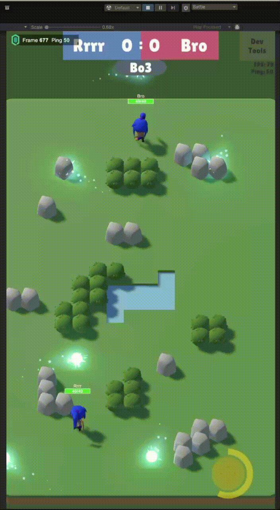

# PvP Quantum Roguelike · Armament feature

A code sample from my mobile PvP roguelike built on **Photon Quantum 3**, a deterministic ECS where every client runs the same simulation from the same inputs. This repository contains one complete gameplay feature: **armaments**, the projectiles and shots that weapons produce.

## About the game

- Real-time PvP matches on Android, with a bot player for testing.
- Room selection, an extensible ability and effect system with synchronised visuals.
- Hybrid architecture: gameplay simulation in Quantum ECS, client UI windows in regular Unity code.

## The feature

**Components** (`ArmamentComponents.qtn`, Quantum DSL): target limits, hit buffers and hit cooldowns per target, team relations, pending shots with intervals, effect and status setups, a reference back to the weapon.

**Systems** (`ArmamentFeature.cs`), run in this order every tick:

| System | Responsibility |
|---|---|
| `MarkProcessedOnTargetLimitExceededSystem` | marks a shot as finished once it has hit its maximum number of targets |
| `MarkProcessedOnObstacleCollisionSystem` | marks a shot as finished when it hits an obstacle |
| `FollowProducerSystem` | keeps attached armaments following their producer |
| `FinalizeProcessedArmamentsSystem` | clears the hit buffers of finished shots and hands them to destruction (`Destructed`) |

Marking first and finalising last keeps every system working on a consistent frame and makes it easy to add new "finish" conditions.

**Factory** (`IArmamentFactory`): one entry point for every shot type (basic, ball, pending burst, ultimate). It takes `Frame`, owner, weapon, level and direction in fixed-point math (`FP`, `FPVector3`), so all shots stay deterministic.

## Notes

This is an excerpt, not a runnable project: it needs the Photon Quantum 3 SDK and the rest of the game code.

## License

MIT
